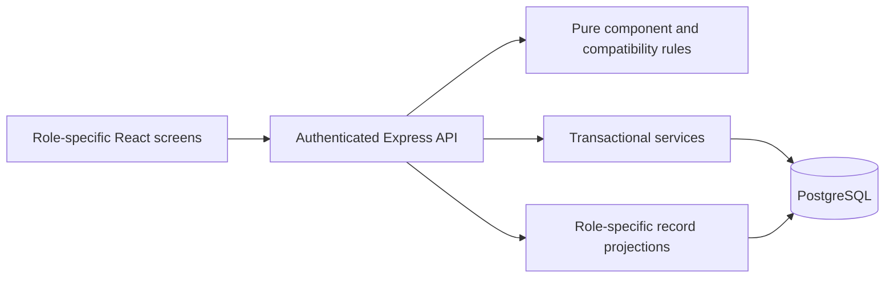
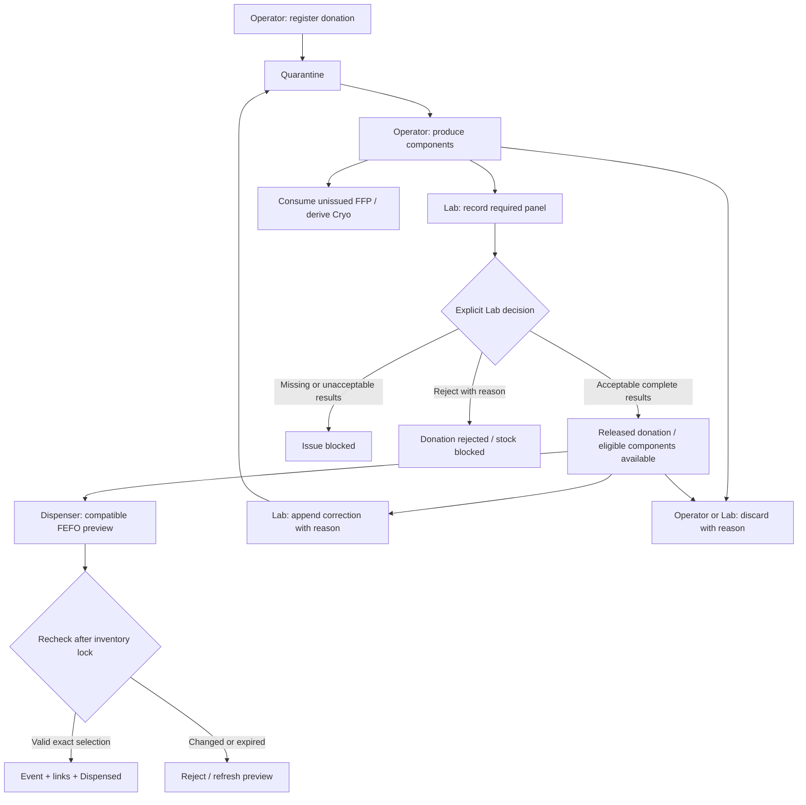
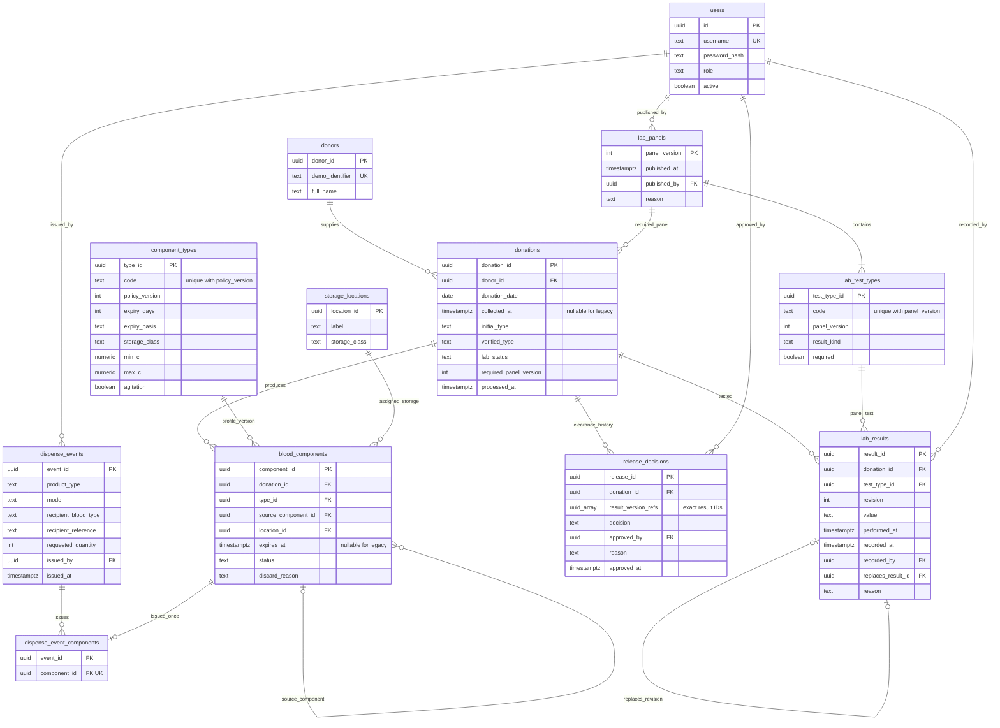

# Implemented architecture

React/TypeScript screens call an Express HTTP API. The server owns validation, role checks, compatibility, selection and PostgreSQL writes. Browser storage holds the session; stock, history and retry receipts persist in PostgreSQL.

Product profiles include an explicit product-specific `expiry_basis` (COLLECTION or SOURCE_EXPIRY), used by the expiry calculation. `lab_panels` records immutable publication metadata; both `donations.required_panel_version` and `lab_test_types.panel_version` reference it. Publishing and intake share the inventory lock, so a donation retains the latest complete published panel. Earlier donations keep their original requirements and result references.

## Workflow

## ERD

`operation_requests` stores the UUID key, operation, fingerprint and original receipt. `inventory_lock` supplies the one-row lock. `audit_logs` stores actor/role, action, outcome, server time, sequence and request metadata with append-only protection. `schema_migrations` tracks SQL versions. Release decision result references are stored as an immutable UUID array rather than a separate join table.

Legacy `blood_units` and `dispense_event_units` remain preserved historical tables. New operations use donations/components. Missing legacy product/time/expiry remains unknown; unissued components stay quarantined and historical issued links are preserved.

All stock, lab, catalogue and account-update mutations acquire the shared lock, read current data under READ COMMITTED and commit state/event links, audit and retry receipt together. This favors clear correctness over concurrent write throughput. Full exports use a REPEATABLE READ snapshot. See [ADR 0002](adr/0002-donations-components-and-laboratory-clearance.md) and [ADR 0003](adr/0003-researcher-aggregate-access.md).
