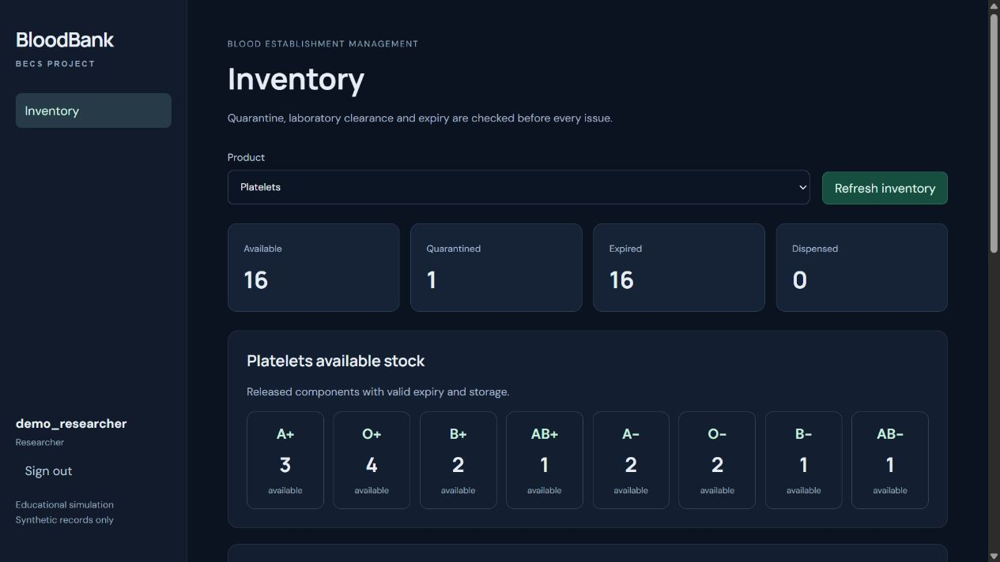

# Approved project plan completion and verification

Verified on 19 October 2026 on branch `feat/becsExpansion`, based on commit `add917a2ad1a980548871ab7b705a501086dcef8` plus the working-tree implementation accompanying this report. The professor-approved proposal is unchanged. This report supersedes the missing-work conclusions in the earlier [audit](../reviews/approved-plan-audit.he.md).

## Implemented corrections

- New donations require an explicit collection timestamp. The server no longer invents midnight when one is omitted; legacy detail completion remains separate.
- Approval accepts and retains a reason with the approving user, time and exact result references. The UI displays an editable review statement. Older API clients that omit the reason receive the same standard statement in the stored decision. Existing immutable decisions are preserved.
- Inventory includes all component statuses by product and blood type, including the aggregate-only researcher response and UI.
- Upcoming expiry means future expiry within the requested horizon for unissued AVAILABLE or QUARANTINED stock, excluding rejected donations. Expired stock remains separately searchable.
- Donation lists open a card containing their components, profile, status, production/expiry times, storage and source links. Laboratory users see the same card without donor-identifying fields.
- Migration 011 adds the explicit product expiry basis without changing an existing expiry. The shared domain calculation uses COLLECTION or SOURCE_EXPIRY, as fixed by the approved simulation product.
- Migration 012 introduces immutable published laboratory panels. Publication and intake share the inventory lock. New donations retain the newest complete published panel; existing donations retain their earlier requirements. The API protects the baseline typing and four screenings, and the administrator UI can add a required screening in a new version. The laboratory form reads the donation's panel instead of a hard-coded list.
- The full export includes panels and records the same format version in the audit as in the JSON file.
- `db:seed -- --batch LABEL` adds fresh synthetic demonstration stock, with separate donor identifiers and stable retry keys, without rewriting old records. The seed completes the actual panel retained by each donation.

## Automated verification

| Check                      | Result                                         |
| -------------------------- | ---------------------------------------------- |
| `npm test`                 | 98 passed, 2 files                             |
| `npm run test:integration` | 110 passed, 5 files, real PostgreSQL           |
| Total                      | 208 passed                                     |
| `npm run build`            | TypeScript, Vite and server compilation passed |
| Docker image build         | Passed with the same frontend asset hashes     |
| `npm run format:check`     | Passed                                         |
| `git diff --check`         | Passed                                         |

Implementation proceeded through failing-test/passing-test slices for collection timestamps, approval reasons, export auditing, inventory breakdown, upcoming expiry, profile expiry and panel publication. Additional regressions verify already implemented business rules. The agreed public boundaries remain exported domain functions and HTTP with PostgreSQL. SQL creates fixtures, establishes lock barriers and injects storage failures; assertions observe domain returns or HTTP responses.

Each integration test schema is isolated inside the distinct `_test` database and is removed after testing. Expected simulated storage failures exercise rollback. The configured GitHub Actions job runs formatting, domain tests, integration tests and build; a remote CI run for these uncommitted changes has not been performed.

## Acceptance case mapping

Some scenarios originally listed as unit tests are also verified at the previously agreed HTTP boundary, where retained panels, result revisions and transaction state are observable.

| Case                                         | Verification                                                                                                                                                                          |
| -------------------------------------------- | ------------------------------------------------------------------------------------------------------------------------------------------------------------------------------------- |
| U01 product shelf lives and profile versions | Domain product/profile tests; HTTP policy version test verifies the new 35-day expiry and unchanged old component                                                                     |
| U02 late approval does not extend expiry     | Acceptance test compares component expiries before and after delayed approval                                                                                                         |
| U03 expiry boundary                          | Domain tests allow 1 ms before expiry and reject the exact instant; HTTP confirmation rejects expiry                                                                                  |
| U04 incomplete profile/expiry                | Domain missing data/LEGACY tests; HTTP missing expiry and incompatible storage fixtures; required intake timestamp                                                                    |
| U05 missing or pending required tests        | Missing-result workflow test and PENDING acceptance case                                                                                                                              |
| U06 reactive or indeterminate result         | Separate REACTIVE and INDETERMINATE acceptance cases                                                                                                                                  |
| U07 typing mismatch                          | Blocking case plus a reasoned correction that still requires explicit approval                                                                                                        |
| U08 acceptable results without approval      | Complete panel remains quarantined; preview and forged confirmation cannot issue it                                                                                                   |
| U09 correction invalidates release           | Workflow revision test and acceptance test preserving old results and blocking the remaining components                                                                               |
| U10 PRBC compatibility                       | Every donor/recipient pair is exercised through the active component allocation engine                                                                                                |
| U11 FFP policy                               | Every donor/recipient ABO/Rh pair and exact-ABO priority are tested separately from red cells                                                                                         |
| U12 Platelets and Cryo                       | Positive and negative cases for the restricted simulation policies                                                                                                                    |
| U13 FEFO                                     | Earlier expiry wins within the blood-type priority                                                                                                                                    |
| U14 deterministic ties                       | Equal expiries use collection time, then component ID                                                                                                                                 |
| U15 bad quantity or shortage                 | Invalid quantities plus an HTTP shortage with no event, links, stock mutation or success audit                                                                                        |
| U16 emergency stock eligibility              | Requested O-negative PRBC quantity; quarantined and expired red cells cannot be substituted by eligible plasma                                                                        |
| U17 consumed source                          | Derivation consumes FFP; repeated processing and attempted FFP issuance are rejected                                                                                                  |
| I01 quarantine intake and processing         | Several linked components from one donation enter quarantine                                                                                                                          |
| I02 issue before release                     | Explicit confirmation of quarantined stock fails without event or links                                                                                                               |
| I03 emergency quarantine/expiry              | Separate blocked emergency cases, with other product stock present                                                                                                                    |
| I04 completed panel and approval             | Eligible components become available only after the release decision                                                                                                                  |
| I05 forged product/type                      | Wrong-product and incompatible-blood-type selections are rejected                                                                                                                     |
| I06 preview-to-confirm expiry                | Existing workflow test plus a request that expires while waiting for its inventory lock                                                                                               |
| I07 laboratory/issue concurrency             | Both requests queue behind a controlled lock; the preceding correction succeeds and the waiting issue fails                                                                           |
| I08 competing issue                          | Routine/emergency and same-key concurrent request regressions                                                                                                                         |
| I09 same-key retry                           | Original receipt returned without another stock change                                                                                                                                |
| I10 different payload under same key         | Conflict response; denied-request auditing and rollback regressions                                                                                                                   |
| I11 audit/link failure                       | Separate injected failures in success auditing and component-link insertion; failed link insertion leaves no event, link or retry receipt and the same key can succeed after recovery |
| I12 role matrix                              | Every denied combination across all five roles and protected routes, including administrator release denial                                                                           |
| I13 invalid/expired/disabled sessions        | Correctly signed expired JWT, malformed/missing token, disabled account and changed role                                                                                              |
| I14 researcher privacy                       | Denied individual-record and export routes; aggregate status breakdown contains no donation ID or activity records                                                                    |
| I15 correction after issue                   | Issued components stay issued, remaining components return to quarantine, earlier results remain and audit identifies the issued IDs                                                  |
| I16 processed source                         | Repeat derivation and explicit issue of the consumed FFP are both rejected                                                                                                            |
| I17 migration                                | Original IDs, issue links, audit, unknown legacy metadata and explicit legacy completion remain covered                                                                               |

Storage-boundary fault tests additionally attempt UPDATE and DELETE during API mutations of results, decisions, product profiles, panels and test definitions. Each attempt fails and the public history/catalogue remains unchanged. Publishing a panel is retry-safe, cannot remove the baseline tests, and does not change earlier donation requirements. Production after prior approval still cannot make an expired component eligible.

Test sources: [domain cases](../../server/src/domain/components.test.ts), [acceptance cases](../../server/tests/acceptance.test.ts), [workflows](../../server/tests/becs.test.ts), [regressions](../../server/tests/api.test.ts), [roles](../../server/tests/auth.test.ts), and [migration](../../server/tests/migration.test.ts).

## Local database update and preservation

A PostgreSQL custom-format backup was created before the update, stored locally outside the repository as `before-approved-plan-20261019.dump` in this chat's visualization `plan-audit` directory. Original rows were fingerprinted before and after the migrations, refresh and browser checks. Every pre-existing donor, donation, component, result, decision, event, issue link, legacy unit, legacy link, operation receipt and audit record was retained without a content change.

The named batch `2026-10-19-approved-plan` added 41 donors/donations, 106 component records, 205 test results and 41 release decisions. Eight FFP components were consumed to derive Cryo; 98 new components were available. Repeating the same command did not add any donor, donation, component, result, decision, event or operation receipt and did not change availability. The expected replay audit events were appended.

| Available product | Before refresh | After refresh and identical retry | After browser acceptance |
| ----------------- | -------------: | --------------------------------: | -----------------------: |
| PRBC              |             32 |                                73 |                       72 |
| FFP               |             33 |                                66 |                       66 |
| Platelets         |              0 |                                16 |                       16 |
| Cryoprecipitate   |              8 |                                16 |                       16 |

At this stage, the original 16 expired platelet components remained expired, the 28 unissued LEGACY components remained quarantined and the 15 issued legacy units remained historical. The later user-requested legacy cleanup is documented below. Missing historical facts and old approval reasons were not invented. Fresh stock comes from new synthetic donations, rather than edited historical expiry dates.

Repeat the prepared batch with:

```sh
docker compose exec -T app node dist/server/server/scripts/seed.js --batch 2026-10-19-approved-plan
```

Use a different label when fresh collection times are needed on another occasion.

## Browser acceptance and running application

The rebuilt Compose application was checked at [the local application](http://localhost:3001) with all five demo roles.

| Scenario                           | Observed result                                                                                                                       |
| ---------------------------------- | ------------------------------------------------------------------------------------------------------------------------------------- |
| Operator intake                    | New synthetic donation `9f9ceedf-afa2-47ec-ac47-30d5a6607dd3`, with explicit collection time, entered quarantine                      |
| Processing                         | PRBC, FFP and Platelets appeared in the linked card with separate IDs, storage, production time, expiry and quarantine status         |
| Incomplete release                 | Rejected with the required-panel message                                                                                              |
| Complete panel                     | All five results displayed while the donation remained quarantined                                                                    |
| Explicit approval                  | A custom reason was submitted; the card and component statuses changed to Released/Available                                          |
| Dispenser preview and cancellation | Compatible A+ allocation appeared; cancellation left stock unchanged                                                                  |
| Dispenser confirmation             | Exactly one eligible PRBC was issued, selected by the normal priority/FEFO rules                                                      |
| Laboratory correction              | A reasoned HIV revision returned the acceptance donation and its unissued components to quarantine; original results remained visible |
| Reapproval with reactive result    | Rejected                                                                                                                              |
| Administrator                      | Explicit expiry bases, panel version metadata and panel publication controls displayed                                                |
| Researcher                         | Inventory navigation only, with the new aggregate breakdown and 16 available Platelets                                                |

The existing automatic tests additionally verify no-authorization, expiry and emergency failure scenarios. Panel changes were exercised against isolated test data; the local demonstration panel remains the approved five-test panel 1.



The application is running locally with migrations 011–012 applied. No public deployment, Git push or commit was made as part of this task.

## Subsequent user-requested legacy cleanup

On 19 October 2026, the user explicitly requested deletion of the legacy data. A fresh full PostgreSQL backup, `before-legacy-delete-20261019.dump`, was saved in this chat's local visualization `plan-audit` directory before deletion.

The committed transaction removed 43 LEGACY components, their 43 donations and 43 original blood-unit rows, 2 legacy issue events, 15 links from each of the old and component issue-link tables, 45 associated retry receipts, and 2 donors with no other donations. Donors shared with newer donations were retained. All application rows outside this exact deletion set were compared before commit and preserved unchanged, including every earlier audit entry, all 422 laboratory results and all 84 release decisions. The transaction appended a `LEGACY_DATA_REMOVED` success audit entry. The immutable LEGACY catalogue profile remains available for migration compatibility.

After cleanup, the running API reports 84 donations and 219 components, zero LEGACY components and zero components without storage. Available stock is unchanged for every blood type: PRBC 72, FFP 66, Platelets 16 and Cryoprecipitate 16. No dangling issue links remain, and both local Compose services are healthy. Verification used the transaction's complete row comparison and the public inventory/export APIs; this data-only cleanup required no application rebuild.
